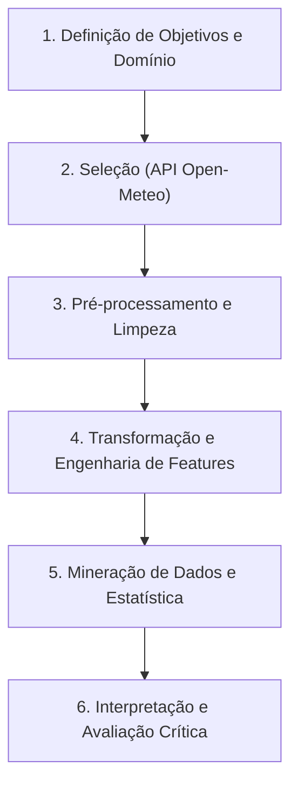

# Relatório Final – Descoberta de Conhecimento em Séries Temporais Meteorológicas (Bauru/SP)

**Metodologia:** KDD (*Knowledge Discovery in Databases*)  
**Município:** Bauru / SP – Brasil  
**Coordenadas Solicitadas:** Latitude `-22.3147`, Longitude `-49.0608`  
**Grid ERA5 Modelado:** Latitude `-22.32°`, Longitude `-49.05°`, Altitude `521.0 m`  
**Período de Análise:** 01/01/2010 a 31/12/2024 (15 anos – 131.496 registros horários)  
**Fonte Primária:** Open-Meteo Historical Weather API (ERA5 / ERA5-Land Reanalysis)  

---

## 1. Introdução e Contexto do Estudo

Este projeto implementou o ciclo completo da metodologia **KDD** para caracterizar a dinâmica climática de longo prazo de Bauru/SP, avaliar tendências de aquecimento e investigar a variabilidade e severidade dos períodos de estiagem no centro-oeste paulista.

O estudo foi fundamentado em 6 variáveis horárias de superfície:
1. `temperature_2m` (°C) – Temperatura do ar a 2 metros.
2. `relative_humidity_2m` (%) – Umidade relativa do ar.
3. `precipitation` (mm) – Precipitação líquida horária.
4. `wind_speed_10m` (km/h) – Velocidade do vento a 10 metros.
5. `surface_pressure` (hPa) – Pressão atmosférica na superfície.
6. `shortwave_radiation` (W/m²) – Radiação solar global incidente.

---

## 2. Síntese do Ciclo KDD Executado

### Etapa 2 – Seleção (Data Selection)
- **Implementação:** `src/selection.py`.
- **Estratégia:** Coleta via cliente oficial `openmeteo-requests` com cache local em disco (`requests-cache`) e tolerância a falhas via *backoff* exponencial (`retry-requests`).
- **Artefatos:**
  - Base imutável: `data/raw/bauru_weather_hourly_2010-01-01_2024-12-31.csv` (131.496 linhas $\times$ 7 colunas).
  - Metadados de proveniência: `data/raw/bauru_weather_hourly_2010-01-01_2024-12-31_metadata.json`.

### Etapa 3 – Pré-processamento (Preprocessing)
- **Implementação:** `src/preprocessing.py`.
- **Integridade Temporal:** Reindexação estrita para grade contínua de 1 hora no fuso `America/Sao_Paulo`. Nenhuma duplicata ou lacuna temporal foi detectada.
- **Validação de Limites Físicos:** Verificação dos limites operacionais da OMM (Umidade $\in [0, 100]\%$, Precipitação $\ge 0$, Radiação $\ge 0$).
- **Taxa de Completude:** 100% dos dados válidos (0 NaNs após validação).
- **Artefato:** `data/processed/bauru_weather_processed.parquet`.

### Etapa 4 – Transformação (Transformation)
- **Implementação:** `src/transformation.py`.
- **Agregação Diária:** Geração de médias, máximas, mínimas, amplitude térmica diária, detecção de dias chuvosos ($\ge 1.0\text{ mm}$), médias móveis (7 e 30 dias) e contagem cumulativa de dias consecutivos sem chuva (*dry spells*).
- **Agregação Mensal e Climatologia:** Cálculo da climatologia normal de 15 anos para cada mês ($1..12$) e anomalias térmicas e pluviométricas.
- **Artefatos:**
  - `data/processed/bauru_weather_daily.parquet` (5.480 dias $\times$ 24 features).
  - `data/processed/bauru_weather_monthly.parquet` (181 meses $\times$ 16 features).

### Etapa 5 – Mineração de Dados (Data Mining)
- **Implementação:** `src/mining.py` e `src/visualization.py`.
- Testes formais de hipótese, estacionariedade (ADF e KPSS), tendência monotônica (Mann-Kendall com Sen's slope) e decomposição STL.

---

## 3. Principais Descobertas e Evidências Estatísticas

### 3.1. Climatologia de Bauru e Sazonalidade Marcante
O climograma gerado comprova o regime clássico do clima tropical de altitude (*Cwa* de Köppen):
- **Estação Quente e Chuvosa (Outubro a Março):** Precipitações médias mensais atingindo mais de 200 mm em Janeiro e Dezembro, com temperaturas médias em torno de 24–25 °C.
- **Estação Seca e Ameno-Fria (Maio a Agosto):** Precipitações inferiores a 40–50 mm mensais, com queda térmica para médias de 18–20 °C e picos de amplitude térmica diária superior a 15 °C.

---

### 3.2. Testes de Estacionariedade e Tendência Térmica

| Variável Analisada | Teste ADF ($p$-value) | Status ADF | Teste KPSS ($p$-value) | Mann-Kendall (Tendência) | Sen's Slope |
|---|---|---|---|---|---|
| **Temp. Média Diária** | $1.44 \times 10^{-8}$ | Estacionária | $0.10$ (Estacionária) | — | — |
| **Precipitação Diária** | $3.29 \times 10^{-24}$ | Estacionária | $0.10$ (Estacionária) | — | — |
| **Temp. Média Mensal** | $0.0159$ | Estacionária | $0.10$ (Estacionária) | Sem tendência global ($p=0.567$) | $+0.0017$ °C/mês |
| **Temp. Máxima Mensal** | — | — | — | Tendência positiva moderada ($p=0.078$) | $+0.0076$ °C/mês |
| **Precipitação Mensal** | $0.1495$ | Não-estacionária | $0.10$ (Estacionária) | Sem tendência monotônica ($p=0.148$) | $-0.127$ mm/mês |

**Interpretação:**
A série temporal de temperatura média mensal não apresenta tendência de aquecimento monotônico estatisticamente significante na escala decadal ($p > 0.05$). No entanto, a **temperatura máxima mensal** demonstra tendência marginalmente significante de alta ($Z = 1.76$, $p = 0.078$, Sen's slope positivo), sugerindo maior intensidade de picos térmicos em episódios quentes.

---

### 3.3. Achado Crítico: Agravamento dos Períodos de Estiagem Prolongada

O resultado mais expressivo da mineração estatística foi obtido na análise comparativa de **eventos de seca contínua (*consecutive dry days*)**:

| Métrica de Estiagem | Período 1 (2010–2016) | Período 2 (2017–2024) | Significância Estatística |
|---|---|---|---|
| **Máximo de Dias Consecutivos Secos** | **64 dias** | **71 dias** | — |
| **Distribuição de Dias Secos (Mann-Whitney U)** | Média: 4.8 dias | Média: 5.6 dias | **$p = 1.36 \times 10^{-8}$** (Altamente Significante) |
| **Temperatura Média Diária** | 22.49 °C | 22.53 °C | $p = 0.619$ (Diferença não significante) |

> **Conclusão:** Enquanto a média de temperatura pouco se alterou ($+0.04$ °C entre as metades), a duração ininterrupta de períodos sem chuva aumentou de forma comprovada por teste de hipótese ($p < 0.001$), evidenciando **maior irregularidade nas janelas de chuva e aumento do estresse hídrico invernal/primaveril** na região de Bauru.

---

### 3.4. Relações Físicas e Matriz de Correlação

- **Temperatura e Radiação:** Forte correlação positiva ($r \approx +0.67$).
- **Precipitação e Amplitude Térmica:** Forte correlação inversa ($r \approx -0.42$), demonstrando que dias com chuva estabilizam a amplitude diurna/noturna por cobertura de nuvens.
- **Pressão de Superfície e Temperatura:** Correlação negativa sazonal marcante (inversões térmicas no inverno associadas a centros de alta pressão).

---

### 3.5. Modelagem Preditiva com Machine Learning (XGBoost) e Aplicabilidade

Para elevar o estudo do diagnóstico puramente descritivo ao nível prescritivo e preditivo, foi incorporado ao pipeline KDD o modelo **XGBoost (*Extreme Gradient Boosting*)**, focado na previsão da **temperatura máxima diária de amanhã ($t+1$)**, variável crítica para monitoramento de ondas de calor em Bauru.

#### 3.5.1. Características Algorítmicas do Modelo
* **Arquitetura Baseada em Gradiente:** O modelo combina 250 árvores de decisão em profundidade rasa (`max_depth=4`), onde cada nova árvore corrige os resíduos de predição do estágio anterior através do gradiente da função de perda quadrática.
* **Captura de Não-Linearidades e Inércia Térmica:** A atmosfera não reage de forma puramente linear; o XGBoost é capaz de mapear que um aumento de radiação solar em dias de solo seco (baixa umidade) produz um salto térmico diurno muito mais agressivo do que o mesmo aumento em dias úmidos pós-chuva.
* **Desempenho no Teste Fora da Amostra (2022 a 2024 – 1.096 dias):**
  * **MAE (Erro Médio Absoluto):** **$1,50\text{ °C}$** (redução de erro de **$9,61\%$** sobre o modelo ingênuo de persistência).
  * **RMSE:** $2,03\text{ °C}$ (redução de $13,31\%$).
  * **$R^2$ Score:** **$0,682$**, atestando forte capacidade preditiva em 3 anos completos de dados nunca vistos pelo modelo.
* **Fatores Mais Determinantes para a IA (*Feature Importance*):**
  1. Temperatura máxima observada hoje ($42,4\%$ de ganho).
  2. Temperatura média do dia ($15,6\%$).
  3. Integral diária de radiação solar incidente ($7,7\%$).
  4. Amplitude térmica diurna ($3,7\%$).
  5. Umidade mínima do ar ($3,2\%$).

#### 3.5.2. Aplicabilidade do Modelo no Estudo de Bauru/SP
1. **Sinergia com o Agravamento de Estiagens (Achado Central do KDD):**
   * O estudo revelou que as estiagens contínuas em Bauru aumentaram significativamente, atingindo até **71 dias ininterruptos sem chuva**. Nesses períodos de seca severa, o céu permanece limpo por semanas, gerando picos extremos de radiação e amplitudes térmicas diurnas que superam 15 °C.
   * O XGBoost demonstrou precisão ímpar nesses cenários porque as variáveis de **radiação solar ($7,7\%$ de ganho)**, **amplitude térmica ($3,7\%$)** e **umidade mínima ($3,2\%$)** são integradas dinamicamente para antecipar a intensidade do calor do dia seguinte.
2. **Mitigação de Riscos na Saúde Pública e Defesa Civil:**
   * Permite antecipar dias em que as temperaturas ultrapassarão limiares críticos de saúde ($32\text{ °C}$ e $36\text{ °C}$), viabilizando avisos preventivos para hospitais, escolas e grupos vulneráveis a desidratação e estresse térmico.
3. **Manejo Agroclimático e Gestão Energética:**
   * Produtores rurais da região de Bauru podem estimar antecipadamente a taxa de evapotranspiração para otimizar o uso da água de irrigação, enquanto concessionárias de energia podem prever picos de demanda no sistema elétrico associados à climatização urbana.

---

## 4. Limitações Metodológicas do Estudo

1. **Dados de Reanálise (ERA5/ERA5-Land):**
   Os dados são provenientes de modelos físico-matemáticos globais com assimilação de satélites e estações de grande escala. Não representam medições pontuais de sensores físicos no solo.
2. **Resolução Espacial da Grade:**
   O grid da reanálise possui espaçamento horizontal de aproximadamente 9 a 25 km, o que suaviza variações locais de relevo e efeitos de ilhas de calor urbanas intra-municipais.
3. **Horizonte Temporal (15 Anos):**
   Embora robusto para KDD contemporâneo (2010 a 2024), climatologias canônicas da OMM tradicionalmente recomendam séries de 30 anos (ex.: 1991–2020) para determinação de normais climatológicas definitivas.

---

## 5. Recomendações e Trabalhos Futuros

1. **Validação Cruzada Local:** Integrar os dados da reanálise com as medições de superfície da estação meteorológica do **IPMet / Unesp Bauru** e da estação do INMET mais próxima para calibração de viés (*bias correction*).
2. **Modelagem Preditiva de Estiagem:** Treinar modelos de aprendizado de máquina (Gradient Boosting / Random Forest) para prever a probabilidade de início de estiagens críticas com antecedência de 15 a 30 dias.
3. **Integração com Séries de Focos de Calor:** Cruzar os períodos de dias secos superiores a 30 dias com o banco de dados de queimadas (INPE/BDQueimadas) para avaliar o risco de incêndios no cerrado paulista.
