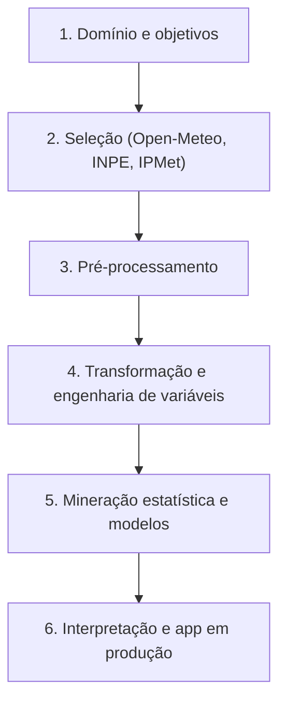
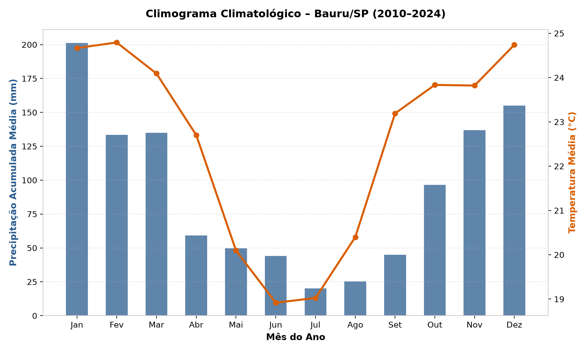
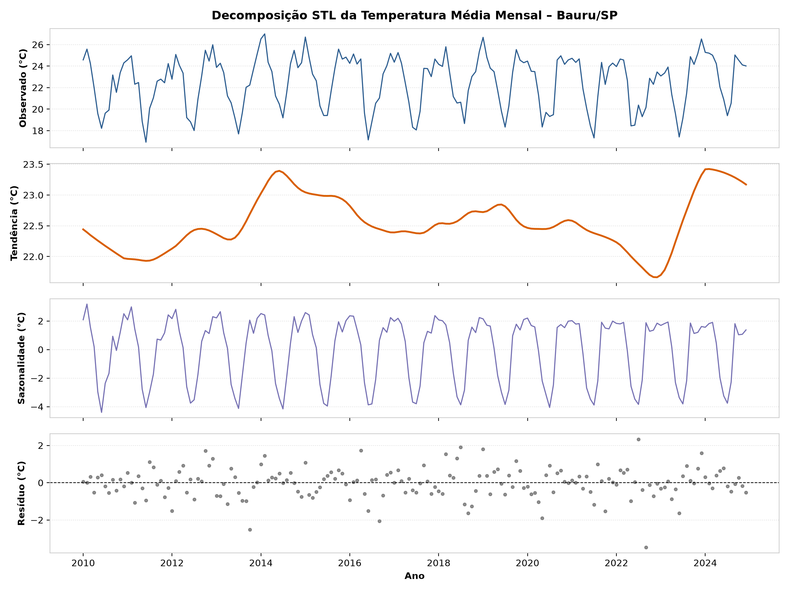
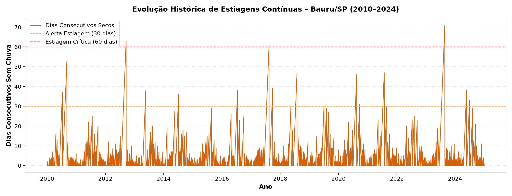
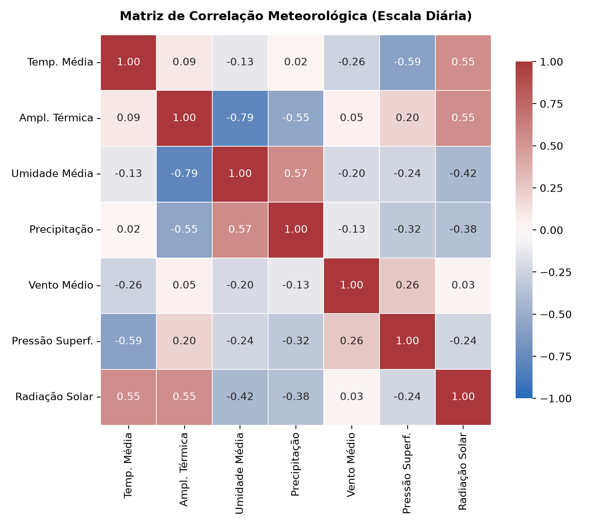

# Relatório Final – Descoberta de Conhecimento em Séries Temporais Meteorológicas (Bauru/SP)

**Metodologia:** KDD (*Knowledge Discovery in Databases*)
**Município:** Bauru / SP – Brasil
**Coordenadas solicitadas:** latitude `-22.3147`, longitude `-49.0608`
**Ponto de grade ERA5:** latitude `-22,320°`, longitude `-49,049°`, altitude `521 m`
**Janela do estudo:** 2010 a 2024 (5.479 dias, 180 meses) — a base continua sendo atualizada diariamente, mas a inferência estatística usa esta janela fixa
**Referência temporal:** horário local padrão (UTC−03:00)
**Fonte primária:** Open-Meteo Historical Weather API (reanálise ERA5 / ERA5-Land)

> Relatório gerado automaticamente por `src/relatorio.py` em 29/10/2026 17:37, a partir de `reports/tables/`.

---

## 1. Introdução

Este projeto aplica o ciclo **KDD** para caracterizar o clima de Bauru/SP, testar se há tendências de aquecimento ou de mudança no regime de chuvas e estiagens, e construir modelos de apoio à decisão para calor extremo e risco de queimada.

Variáveis horárias de superfície: `temperature_2m` (°C), `relative_humidity_2m` (%), `precipitation` (mm), `wind_speed_10m` (km/h), `surface_pressure` (hPa) e `shortwave_radiation` (W/m²).

---

## 2. Síntese do Ciclo KDD

### Seleção — `src/selection.py`
Cliente oficial `openmeteo-requests` com cache em disco e *retry* com *backoff* exponencial. Os instantes da API (segundos Unix em UTC) são convertidos para horário local somando o deslocamento da resposta.

### Pré-processamento — `src/preprocessing.py`
- Une a carga histórica aos lotes incrementais de `data/raw/`.
- **Fuso horário:** a carga histórica antiga estava em UTC; o deslocamento aplicado nesta execução foi de **-3 h**.
- Continuidade: 0 duplicatas removidas, 0 horas faltantes inseridas.
- Limites físicos validados e valores ausentes tratados (interpolação temporal limitada a 3 h; chuva ausente = 0 mm).
- Base horária final: **147.456 registros** (2010-01-01 00:00:00 a 2026-10-27 23:00:00).

### Transformação — `src/transformation.py`
Agregações diárias e mensais com a função certa para cada variável (média, mínimo, máximo, soma), dias consecutivos sem chuva, médias móveis, *lags*, seno/cosseno do dia do ano e anomalias em relação à climatologia fixa de 2010–2024.

---

## 3. Principais Descobertas

### 3.1 Climatologia
- Temperatura média: **22,5 °C**; mês mais quente: fev (24,8 °C); mais frio: jun (18,9 °C).
- Chuva média anual: **1.102 mm**; janeiro ≈ 201 mm e julho ≈ 20 mm.
- Amplitude térmica diária: 8,6 °C em janeiro e 12,7 °C em setembro.
- Recordes diários: máxima de 39,7 °C (2020-10-07) e mínima de 3,5 °C (2021-07-29).

### 3.2 Estacionariedade (ADF e KPSS)
ADF: H0 = não estacionária. KPSS: H0 = estacionária. Usados juntos porque as hipóteses nulas são opostas.

| Série | ADF (estatística) | ADF (p) | KPSS (estatística) | KPSS (p) | Leitura |
|---|---|---|---|---|---|
| Temperatura Média Diária | -6,64 | 5,58 × 10^-9 | 0,053 | ≥ 0,10 | Estacionária (os dois testes concordam) |
| Precipitação Diária | -12,92 | 3,82 × 10^-24 | 0,292 | ≥ 0,10 | Estacionária (os dois testes concordam) |
| Temperatura Média Mensal | -2,98 | 0,037 | 0,031 | ≥ 0,10 | Estacionária (os dois testes concordam) |
| Precipitação Mensal | -2,66 | 0,081 | 0,154 | ≥ 0,10 | Inconclusiva (os testes discordam) |

### 3.3 Tendências (Mann-Kendall e declive de Sen)
Séries mensais usam o **Mann-Kendall sazonal**, que compara cada mês com o mesmo mês dos outros anos; o teste original não é adequado para séries com sazonalidade forte.

| Série | Teste | Z | p-valor | Sen | Conclusão (α = 5%) |
|---|---|---|---|---|---|
| Temperatura Média Mensal | Mann-Kendall sazonal (período 12) | 1,24 | 0,214 | 0,0247 °C/ano | Sem tendência significativa |
| Temperatura Máxima Mensal | Mann-Kendall sazonal (período 12) | 3,40 | 6,66 × 10^-4 | 0,1000 °C/ano | Tendência significativa |
| Temperatura Mínima Mensal | Mann-Kendall sazonal (período 12) | -1,67 | 0,094 | -0,0630 °C/ano | Sem tendência significativa |
| Precipitação Total Mensal | Mann-Kendall sazonal (período 12) | -1,69 | 0,092 | -1,2000 mm/ano | Sem tendência significativa |
| Maior Estiagem de Cada Ano | Mann-Kendall original | 0,15 | 0,881 | 0,0000 dias/ano | Sem tendência significativa |

### 3.4 Comparação entre subperíodos (2010-2016 × 2017-2024)

**Temperatura (médias anuais):** 22,49 °C × 22,53 °C (diferença de 0,04 °C; Welch p = 0,883; Mann-Whitney p = 0,867). A diferença não é estatisticamente significativa.

**Estiagens (por evento):** cada sequência ininterrupta de dias sem chuva é uma observação.

| Métrica | 2010-2016 | 2017-2024 |
|---|---|---|
| Eventos de estiagem | 298 (42,6/ano) | 335 (41,9/ano) |
| Duração média | 5,3 dias | 6,0 dias |
| Duração mediana | 3 dias | 3 dias |
| Maior estiagem | 63 dias | 71 dias |
| Eventos com 10 dias ou mais | 41 | 51 |
| Eventos com 30 dias ou mais | 6 | 12 |

Mann-Whitney sobre as durações: **p = 0,314** — a diferença não é estatisticamente significativa. A maior estiagem do estudo ocorreu em **2023 (71 dias)**.

> **Correção metodológica (29/10/2026).** A versão anterior deste relatório comparou o contador diário de dias secos com Mann-Whitney e obteve p ≈ 1,4 × 10^-8, apresentado como “agravamento comprovado”. O contador não é independente: uma estiagem de 40 dias gera 40 valores (1, 2, …, 40), o que infla artificialmente a significância. A comparação correta é por evento, como na tabela acima.

### 3.5 Correlações físicas (escala diária, Pearson)
- Temperatura máxima × radiação solar: **r = 0,69**
- Chuva × amplitude térmica: **r = -0,55** (nuvens reduzem o aquecimento diurno)
- Temperatura média × pressão: **r = -0,59** (massas de ar frio vêm com alta pressão)
- Umidade média × amplitude térmica: **r = -0,79**

---

## 4. Modelo 1 — Temperatura máxima de amanhã (XGBoost Regressor)

- **Alvo:** temperatura máxima do dia seguinte (t+1); 23 variáveis do dia t (condições, médias móveis, *lags*, ciclo anual).
- **Divisão cronológica:** treino 2010-2021 (4.376 dias); teste cego 2022-2024 (1.096 dias).
- **Baseline:** persistência (amanhã = hoje).

| Métrica | XGBoost | Persistência | Ganho |
|---|---|---|---|
| MAE | 1,51 °C | 1,69 °C | 10,7% |
| RMSE | 2,05 °C | 2,42 °C | 15,3% |
| R² | 0,680 | — | — |

Variáveis mais importantes (ganho):
  1. `temp_max` (43,6% do ganho)
  2. `temp_mean` (16,3% do ganho)
  3. `solar_radiation_sum` (5,8% do ganho)
  4. `precipitation_sum` (3,5% do ganho)
  5. `thermal_amplitude` (3,0% do ganho)

**Leitura:** o ganho sobre a persistência é real, porém modesto; o modelo demonstra o método e não substitui uma previsão numérica do tempo.

---

## 5. Modelo 2 — Risco de queimada amanhã (XGBoost Classifier)

- **Alvo:** foco de queimada no dia seguinte (t+1), a partir das condições do dia t.
- **Classe rara:** prevalência de 1,8% no treino (65 dias positivos); `scale_pos_weight` = 55,18.
- **Divisão:** treino até 2019 (3652 dias), validação 2020–2021 (731), teste 2022-2025 (1461 dias, 30 positivos).
- **Calibração:** Platt scaling ajustado na validação.

| Métrica (teste) | Valor | Referência |
|---|---|---|
| ROC-AUC | 0,763 | 0,5 = acaso |
| PR-AUC | 0,048 | 0,021 = acaso (prevalência) |
| Brier (calibrado) | 0,0200 | 0,0201 = sempre prever a taxa-base |
| Brier Skill Score | 0,007 | > 0 = melhor que a taxa-base |

**Leitura:** o modelo é útil para **ordenar** os dias por risco (índice relativo), mas as probabilidades calibradas variam pouco em torno da taxa-base. No app, o escore do modelo ponderado é apresentado como **índice de risco relativo**, e não como probabilidade.

---

## 6. Limitações

1. **Reanálise, não medição:** grade de ~9–25 km; não representa um sensor pontual nem ilhas de calor urbanas.
2. **Horizonte de 15 anos:** curto para tendências climáticas (a OMM usa normais de 30 anos).
3. **Rótulo de queimada ruidoso:** a ausência de foco detectado não garante ausência de fogo (nuvens, resolução e horário de passagem do satélite).
4. **Dados ao vivo no app:** a previsão de amanhã usa previsão numérica ou o sensor do IPMet como entrada, e não a reanálise usada no treino.

## 7. Trabalhos Futuros

1. Correção de viés da reanálise com o histórico da estação IPMet/UNESP (ex.: *quantile mapping*).
2. Validação cruzada temporal e SHAP no regressor; comparação com a previsão da Open-Meteo para o dia seguinte.
3. Modelo de queimada com janelas de vários dias e área ampliada (município + vizinhos), para mais eventos positivos.
4. Estender a série para 30 anos ou mais (ERA5 desde 1940).
